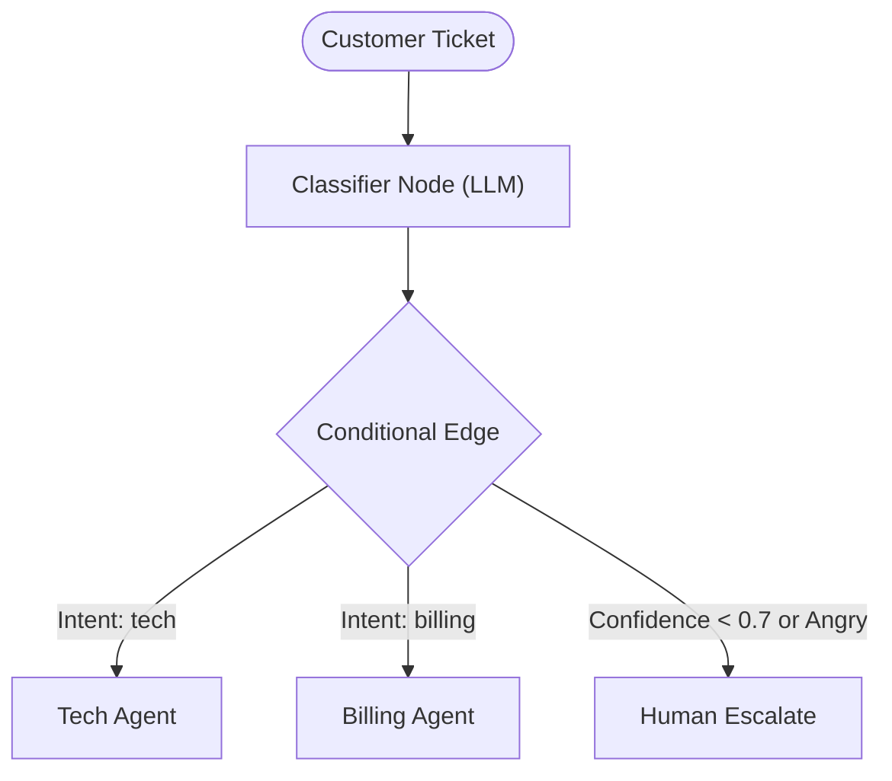

# Architecture — support-triage-graph
> Last updated: 2026-08-29 | Maturity: Partial Prototype
> _Stateful customer support ticket routing with LangGraph._

## System Diagram

## Component Table
| Component | File | Responsibility | Tech |
|---|---|---|---|
| Graph Definition | `src/graph.ts` | Edges and Nodes | LangGraph.js |
| Classifier | `src/nodes/classifier.ts` | Intent/Sentiment extraction | LangChain |
| Sandbox Stub | `tests/e2e/test_sandbox.sh` | Simulates provider/metrics eval | Bash |

## Dependency Honesty Table
| Dependency | Status | Notes |
|---|---|---|
| LangGraph | **Real** | Full state graph implementation. |
| OpenAI | **Real/Mocked**| Hits real API if key present, else mocks. |
| Zendesk | **Simulated**| Adapter stubs represent ticketing backend. |
