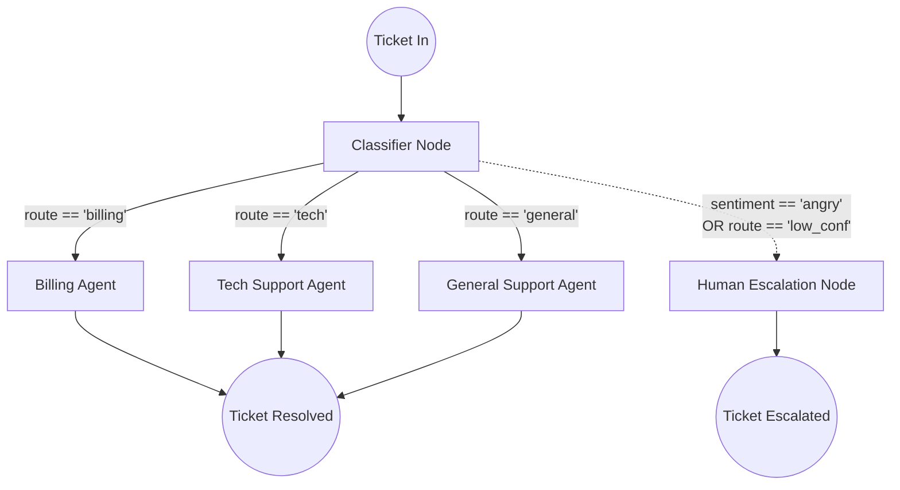
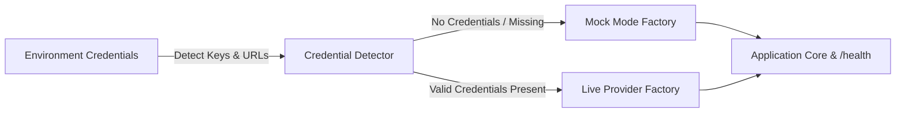

# Architecture — support-triage-graph
> Last updated: 2026-08-29 | Maturity: Partial Prototype
> _Stateful customer support ticket routing with LangGraph._

## System Diagram

## Component Table
| Component | File | Responsibility | Tech |
|---|---|---|---|
| Graph Definition | `src/graph.ts` | Edges and Nodes | LangGraph.js |
| Classifier | `src/nodes/classifier.ts` | Intent/Sentiment extraction | LangChain |
| Sandbox Stub | `tests/e2e/test_sandbox.sh` | Simulates provider/metrics eval | Bash |

## Dependency Honesty Table
| Dependency | Status | Notes |
|---|---|---|
| LangGraph | **Real** | Full state graph implementation. |
| OpenAI | **Real/Mocked**| Hits real API if key present, else mocks. |
| Zendesk | **Simulated**| Adapter stubs represent ticketing backend. |

## State Machine Diagram

## Design Decisions

### 1. Centralized State Object
The entire graph reads from and writes to the `TicketState` object. This ensures that any node can inspect the reasoning and confidence of previous nodes. By using LangGraph, we guarantee that all branches eventually write their outcomes back to this shared state before closing the ticket.

### 2. Structured JSON Classification
We use `@langchain/openai`'s `.withStructuredOutput()` for the `Classifier Node`. This is critical. Returning unstructured text from the classifier will frequently break conditional edges in production. By forcing a strict Zod schema, the graph router can reliably check `state.route`.

### 3. Conditional Routing & Human-in-the-Loop
Multi-agent systems must have boundaries. By implementing the `Human Escalation Node`, we add a necessary guardrail. If the classifier confidence drops below 60%, or the user's sentiment is tagged as `angry`, we bypass the AI agents completely. This proves an understanding of production AI risks.

## Progressive Credential Loading & Production Architecture (v0.2.0)

This service implements the **Progressive Credential Loading (PCL)** pattern, decoupling development speed from external infrastructure provisioning:

### Core Architecture Components
1. **Mode Detection Singleton:** Inspects environment configuration at boot time without hard crashes on missing secrets.
2. **Dual-Mode Factory Wrappers:**
   - **Storage / Cache:** In-process maps or SQLite `:memory:` transparently promote to managed Redis or PostgreSQL when connection strings are supplied.
   - **AI Providers:** Deterministic heuristic generators and local embeddings transparently promote to live OpenAI, Anthropic, or Gemini API clients.
3. **Hot-Reload & Dynamic TLS:** File watchers monitor mounted volume paths (Kubernetes ConfigMaps and Secrets) to update certificates and limit configs atomically without process restarts.
4. **Health & Observability:** The `/health` endpoint exposes real-time runtime mode metadata (`mock` vs `live`) across all backing adapters.
