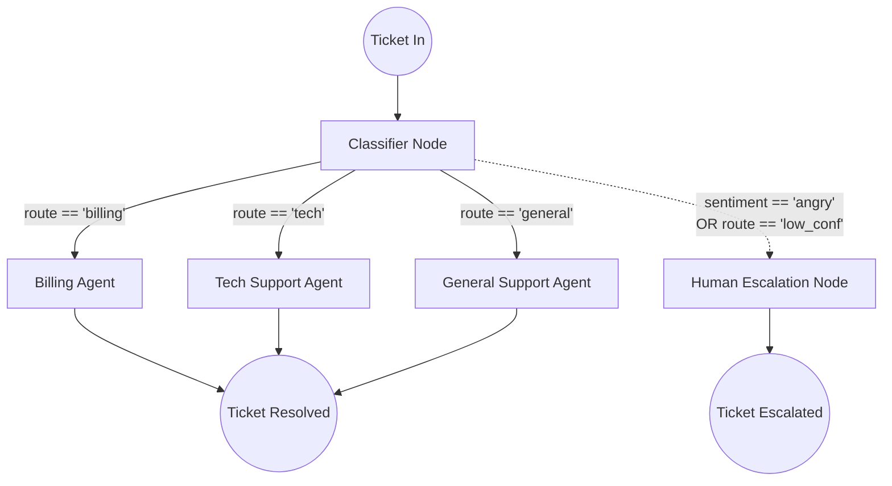

# Architecture: Support Triage Graph

This project implements a state machine using **LangGraph.js**.

## State Machine Diagram

## Design Decisions

### 1. Centralized State Object
The entire graph reads from and writes to the `TicketState` object. This ensures that any node can inspect the reasoning and confidence of previous nodes. By using LangGraph, we guarantee that all branches eventually write their outcomes back to this shared state before closing the ticket.

### 2. Structured JSON Classification
We use `@langchain/openai`'s `.withStructuredOutput()` for the `Classifier Node`. This is critical. Returning unstructured text from the classifier will frequently break conditional edges in production. By forcing a strict Zod schema, the graph router can reliably check `state.route`.

### 3. Conditional Routing & Human-in-the-Loop
Multi-agent systems must have boundaries. By implementing the `Human Escalation Node`, we add a necessary guardrail. If the classifier confidence drops below 60%, or the user's sentiment is tagged as `angry`, we bypass the AI agents completely. This proves an understanding of production AI risks.
